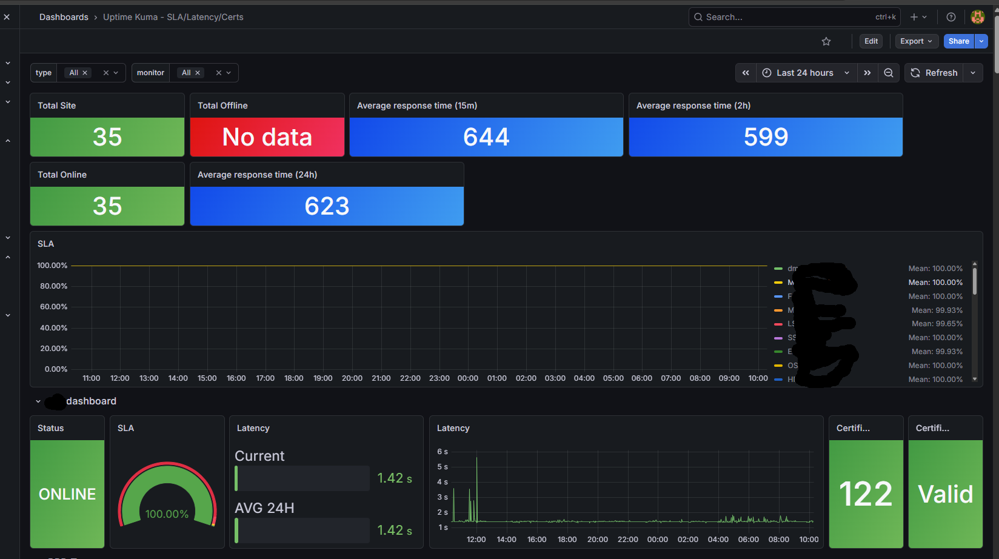

# outage-forecast

**AI-assisted predictive monitoring for Uptime Kuma — self-hosted, no SaaS, no cloud dependency.**

Uptime Kuma's dashboard only shows ~1 week of history and alerts you *after* something breaks. `outage-forecast` adds a layer on top: long-term retention, flapping detection, recurring-failure pattern detection, monitor-to-monitor correlation, and a lead-time early-warning signal — all backed by a local LLM that writes the alerts in plain Bangla.

Main script: [`ai-predictor.py`](https://github.com/cyraxabir/outage-forecast/blob/main/ai-monitor/ai-predictor.py)




---


## ✨ Key Features

### 1. 🧠 Self-Correcting AI Outage Forecasting
* **Closed-Loop Learning:** Every 30 minutes, the engine scores past forecasts (`HIT` / `MISS` / `UNKNOWN`) and feeds the scorecard back into the LLM prompt alongside cleaned historical outage episodes.
* **Bangladesh Workday Awareness (`Sun–Thu`):** Recognizes traffic-driven `.gov.bd` and enterprise patterns that occur on Sunday–Thursday working days and pause on Friday–Saturday weekends.
* **Bimodal Peak & Midnight Wrap-Around Support:** Detects dual daily traffic peaks (e.g., `11:00, 15:30`) and cross-midnight maintenance clusters (`23h–00h`).
* **Deterministic Back-Testing (Hard Veto):** Every AI-proposed rule is tested against the monitor's own observation history. Rules must achieve at least **3 historical hits** and **2.0x lift over random Poisson chance**. Overconfident AI probabilities are automatically capped at the empirical hit rate.
* **Auto-Muting:** Monitors whose recent forecasts fall below a 40% hit rate are automatically muted until their accuracy recovers.

### 2. ⚡ Hybrid "Watch + Live RT" Dynamic Promotion
* Forecasts that pass the statistical lift test but have moderate historical probability (`30%–49%`) are placed in `watch` mode (silent by default).
* If a `watch` window opens **and** live response time or latency jitter spikes simultaneously, the engine dynamically promotes the forecast into an active **Hybrid AI + Live RT Alert**.

### 3. 📈 Multi-Signal Early Warning (Pre-Outage Detection)
* Tracks every monitor's historical **Lead-Time Reliability** (what percentage of past outages were preceded by latency degradation in the 30 minutes prior).
* Filters out `0.0ms` failed-scrape artifacts so pre-outage calculations are never poisoned.
* Triggers early warnings on proven monitors using three live signals:
  * **Absolute Latency Rise:** `>= 100ms` increase.
  * **Relative Percentage Spike:** `>= 45%` increase above baseline (with a `35ms` noise floor) for fast APIs.
  * **RT Jitter / Variance Spike:** Coefficient of Variation (`CV >= 0.55`) to catch connection pool exhaustion before averages climb.

### 4. ⛓️ Live Directional Cascading Alerts (`Leader → Follower`)
* Computes directional lag correlations across all monitors.
* When an upstream **Leader** service goes down, if a downstream **Follower** historically drops within 10 minutes at least `60%` of the time, the engine immediately fires a **Cascading Outage Risk** heads-up while the follower is still `UP`.

### 5. 🌐 Shared Infrastructure / BCC Network Detection
* Automatically groups BCC-hosted portals (`Banglabiz`, `DFQT+`, `Mutation-Prod`, etc.) into time buckets.
* If multiple BCC sites drop together across consecutive windows, individual monitor alerts are suppressed in favor of a single consolidated **BCC Network Issue** alert.

### 6. 📊 Automated Bangla Daily Digests & Weekly Reports
* **Daily Digest (08:00):** 24-hour health summary, verified simultaneous outage overlaps, and upcoming 24-hour forecast windows.
* **Weekly SRE Report (Monday 09:00):** Week-over-week flap/downtime comparison, outage duration trends (`বাড়ছে` / `কমছে` / `স্থির`), directional correlations, lead-time reliability table, and AI forecast accuracy audit.

---

## 🏗️ Architecture Flow

```text
Prometheus (Uptime Kuma Metrics)
       │
       ▼
┌──────────────────────────────────────────────────────────┐
│ 1. Python Compute Layer (Deterministic)                  │
│    • Deduplicates outage episodes & tracks first_seen    │
│    • Computes flaps, relative RT %, jitter CV, duration  │
│    • Checks BCC shared network & Leader->Follower risks  │
└──────┬───────────────────────────────────────────┬───────┘
       │                                           │
       ▼ (Flapping Monitors)                       ▼ (Due Monitors)
┌─────────────────────────────┐     ┌──────────────────────────────────┐
│ 2. Batch AI Triage (Qwen3)  │     │ 3. AI Pattern Learner (Qwen3)    │
│    • Single batched call    │     │    • Reads episodes, 2h clusters │
│    • Compares against       │     │      & past HIT/MISS scorecard   │
│      monitor's own baseline │     │    • Outputs symbolic rule       │
└──────┬──────────────────────┘     └──────────────┬───────────────────┘
       │                                           │
       ▼                                           ▼
┌─────────────────────────────┐     ┌──────────────────────────────────┐
│ 4. Severity Hard Veto       │     │ 5. Poisson Back-Test & Capping   │
│    • Downgrades unproven    │     │    • Per-monitor history span    │
│      HIGH/CRITICAL claims   │     │    • Caps prob_pct at hit-rate   │
└──────┬──────────────────────┘     └──────────────┬───────────────────┘
       │                                           │
       └───────────────────┬───────────────────────┘
                           ▼
                Discord Webhook Embeds

```
---
### How It Predicts Outages

* Time-Window Forecasts: Learns recurring daily, workday (Sun–Thu), and interval patterns from past episodes, back-tests them against random chance, and alerts up to 2 hours before the window opens.

* Latency & Jitter Early Warnings: Alerts while a monitor is still UP if response time spikes (+45% or +100ms) or gets erratic (CV >= 0.55), provided past drops on that site were historically preceded by slowdowns.

* Hybrid Watch Promotion: Combines moderate-probability time windows (30%–49%) with live response-time spikes to catch borderline outages right as traffic stress begins building.

* Live Cascading Alerts: Predicts an imminent drop on a healthy downstream monitor (Follower) the moment an upstream monitor (Leader) goes down, using historical lag correlation.


- **Uptime Kuma** — service monitoring, exposes `/metrics`
- **Prometheus** — long-term metrics storage
- **Grafana** — SLA / latency dashboards
- **Ollama** — self-hosted LLM, no data leaves the network
- **Discord** — alert delivery, in Bangla

## Setup

### 1. Run the base stack (Docker)

```bash
# Uptime Kuma
docker run -d --name uptime-kuma --restart always -p 3001:3001 -v uptime-kuma:/app/data louislam/uptime-kuma:1

# Prometheus (180-day retention)
docker run -d --name prometheus --restart always -p 9091:9090 \
  -v /path/to/prometheus.yml:/etc/prometheus/prometheus.yml \
  -v prometheus_data:/prometheus \
  prom/prometheus:latest \
  --config.file=./prometheus/prometheus.yml \
  --storage.tsdb.path=/prometheus \
  --storage.tsdb.retention.time=180d

# Grafana
docker run -d --name grafana --restart always -p 3000:3000 -v grafana_data:/var/lib/grafana grafana/grafana:latest
```

Then in Uptime Kuma, enable the `/metrics` endpoint (Settings → Security), and point Prometheus at it via a `uptime-kuma` scrape job (`scheme: http`, `basic_auth`).

### 2. Configure the script

```bash
cp ai-monitor/config.example.py ai-monitor/config.py
```

```python
OLLAMA_API_KEY  = "your-ollama-api-key"
PROMETHEUS_URL  = "http://your-prometheus-host:9091"
OLLAMA_URL      = "https://your-ollama-endpoint/api/v1/chat/completions"
OLLAMA_MODEL    = "qwen2.5:14b"
DISCORD_WEBHOOK = "https://discord.com/api/webhooks/..."
```

### 3. Install dependencies

```bash
pip install -r requirements.txt --break-system-packages
```

### 4. Test run

```bash
python3 ai-monitor/ai-predictor.py
```

### 5. Schedule via cron

```bash
crontab -e
```
```
*/30 * * * * /usr/bin/python3 /opt/outage-forecast/ai-monitor/ai-predictor.py >> /var/log/ai-predictor.log 2>&1
```

---

## How prediction stays honest

This project deliberately avoids the common failure mode of AI-monitoring tools: letting the model narrate confidence it doesn't have.

- **Early warning only fires for monitors with proven history** — a brand-new monitor never gets a fabricated prediction, it just shows "insufficient history."
- **Overlap/correlation claims are computed, not guessed** — the AI prompt explicitly forbids claiming shared-infrastructure causes unless real timestamp overlap was found.
- **Severity is capped by confidence** — low-confidence trend data can't produce a HIGH/CRITICAL alert.
- **Normal recovery cycles are filtered out** — if the AI judges a flap pattern as a normal recovery cycle with LOW severity, no alert is sent at all.

---

## Data files (created automatically)

| File | Purpose |
|---|---|
| `uptime_history.json` | Downtime timestamps per monitor — feeds pattern detection |
| `uptime_events.json` | Completed down-events with duration + pre-outage RT trend — feeds duration trend, correlation, lead-time |
| `uptime_state.json` | Alert cooldowns + last digest/report dates |

These accumulate over time. Pattern detection needs 14+ days; correlation and lead-time need 5+ recorded events per monitor.

---

## Roadmap

- [ ] Facebook Prophet-based probabilistic forecasting once 180 days of history accumulates
- [ ] Optional Loki log-pull on downtime for real root-cause context
- [ ] Configurable alert channels (Slack / Telegram in addition to Discord)

---

## License

MIT
